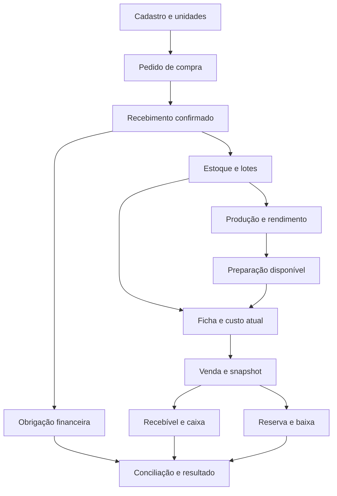

# Consolidação do Carioca’s Pro

Data de referência: 22/10/2026, America/Sao_Paulo. Este documento adota perspectivas de operação, custos, finanças, produto, engenharia, segurança e experiência de uso; não representa parecer de profissionais contratados.

## 1. Fonte e limites do diagnóstico

Base inspecionada: `TaianaDias/cariocas-pro`, branch `refactor/dashboard-clean-v2`, commit `ac9ab8fef7369756c464171f3d868c1cd34d2c96`, de 17/09/2026. A branch `master` permanece em `1b08c6a`, de 09/09. A busca anterior que retornou apenas setembro/09 não representava toda a V2.

O clone local continha código e documentação; não continha dados reais do Firestore nem acesso à VPS. Registros de conversa de 07/10 citam mudanças locais em precificação ainda sem commit. Portanto, esta branch não comprova o estado atualmente executado na loja. A comparação com a VPS é um requisito de publicação, não um motivo para descartar o trabalho existente.

Legenda utilizada:

- **Confirmado:** observado no código, documentação versionada ou teste identificado.
- **Hipótese:** explicação plausível ainda sem evidência suficiente.
- **Decisão proposta:** regra recomendada para as etapas seguintes.
- **Ausente:** evidência ou entrada necessária não disponível.

Estados de cada entrega: **planejado → implementado → testado → homologado na operação → publicado**. Um estado não implica o seguinte. Homologação requer execução do roteiro na operação pela responsável; publicação requer identificar a versão, implantar e conferir seu funcionamento.

### Stack confirmada pelo lockfile e instalação

| Parte | Confirmado nesta base |
|---|---|
| Aplicação | Next.js 15.5.18, App Router; React/ReactDOM 19.2.6; TypeScript 5.9.3 |
| Dados e identidade | Firebase 11.10.0; Firestore; Firebase Auth; Firebase Admin 13.10.0 |
| Validação | Zod 4.4.3 |
| Interface | React, CSS próprio e tokens; componentes compartilhados |
| Organização | `app/api`, `components`, `hooks`, `services`, `schemas`, `lib`, `server`, `types` |
| Infraestrutura documentada | VPS, PM2, Nginx, Docker/Evolution; disponibilidade e versões reais não verificadas |
| Teste desta entrega | Node 24.19.0, Auth/Firestore Emulator em projeto `demo-`, testes de negócio/API/regras |

A arquitetura atual é suficiente para começar. A proposta é manter Next/Firebase e criar fronteiras claras entre cálculos puros, operações transacionais e interface. Uma reescrita ou separação em microsserviços aumentaria migração e manutenção sem resolver primeiro os erros encontrados.

### Constatações que alteram a prioridade

| Código inspecionado | Problema confirmado na base | Consequência | Tratamento |
|---|---|---|---|
| `services/precificacao.service.ts` | Arredondava custo unitário de uso para 2 casas | R$ 0,035/g podia virar R$ 0,04/g: 160 g passavam de R$ 5,60 para R$ 6,40 | Corrigido na entrega 1 |
| Mesmo arquivo e `estoque.service.ts` | Ausência e zero confundidos; atualização trocava a unidade da linha sem converter quantidade | CMV subestimado ou quantidade interpretada em outra unidade | Corrigido no novo fluxo de fichas; normalização geral de estoque permanece pendente |
| `api/precificacao/recalcular` | Rota de servidor usava serviços do SDK cliente, regravava fichas e aplicava configurações padrão | Autorização inconsistente, histórico desnecessário, parâmetros sobrescritos | Consulta recalculada via Admin; versões salvas preservadas |
| `api/financeiro/resumo` | Variações `-2.5` e `1.2` fixas; ticket usa estoque e número de movimentos, não pedidos vendidos | Números que parecem medidos sem base de vendas | Prioridade seguinte; não interpretar como resultado apurado |
| Mesmo endpoint | Série mensal reaproveita o estoque atual para meses anteriores | Não representa evolução histórica do estoque/resultado | Exige snapshots/eventos e fontes temporais reais |
| `server/compras-flow.ts`, recebimento | Grava saldo, histórico e pedido em chamadas separadas; sem chave de recebimento | Falha parcial, duplicação e perda de atualização concorrente | Bloqueio da etapa de recebimento confiável |
| `services/xml.service.ts` | Recebimento e custo tratados em caminho próprio de gravações | Reprocessamento e divergência entre fontes | Unificar comando de recebimento após inventário das fontes |
| `services/producao-porcoes.service.ts` e API operacional | Caminhos diferentes; serviço cliente faz gravações sucessivas; API contém transação | Comportamentos diferentes conforme entrada | Consolidar em comando servidor na etapa de produção |
| `firestore.rules` | Regra genérica coincidindo com `/usuarios` podia liberar edição administrativa de campos protegidos | Plano/perfil protegidos na regra específica podiam ser contornados | Corrigido e testado localmente na entrega 1 |
| Mesmo arquivo | Liberação recursiva por empresa não restringia lojas nos documentos internos | Acesso indevido entre lojas do mesmo tenant | Restrição aplicada às coleções internas diretas; migração precisa de homologação |
| `lib/access-control.ts` | Papel desconhecido normaliza para o legado administrativo `user` | Novos papéis podem receber acesso excessivo em caminhos antigos | Novo fluxo exige papel explícito; revisão global pendente |
| `scripts/backup-firestore.sh` | Exportação assíncrona; mensagem final não confere conclusão nem restauração | Existência do script não comprova recuperação | Requisito de liberação comercial |

Não foi encontrada na base inspecionada uma implementação completa de vendas/POS, contas a pagar/receber, conciliação e DRE integrada ao ciclo. Nomes de canais na precificação não são integrações de pedidos.

## 2. Mapa dos módulos, dependências e efeitos

| Módulo | Entrada e dependências | Saída e efeitos permitidos | Situação antes desta entrega |
|---|---|---|---|
| Identidade/empresa/loja | Firebase Auth + perfil no servidor | Contexto obrigatório e ações autorizadas | Implementado em parte; regras reais publicadas ausentes |
| Cadastro e apresentações | Insumo canônico, fornecedor, unidades e fatores | Registro reutilizável sem saldo fictício | Cadastro existente; pré-compra com origem de custo acrescentado nesta entrega |
| Compras | Necessidade, cotações, aprovação | Pedido autorizado; não altera saldo nem baixa banco | Central e estados existentes |
| Recebimento | Pedido, documento de origem, quantidade, custo e lotes | Movimento de entrada, custo e obrigação vinculada | Existente; atomicidade/idempotência incompletas |
| Estoque | Movimentos confirmados por depósito/lote | Saldos, reservas, inventários e alertas | Saldos/histórico/alertas existentes; razão completo pendente |
| Produção | Ficha versionada + matérias-primas disponíveis | Consumo de componentes, lote da preparação e rendimento | Porcionamento existente; perda/rendimento e caminhos precisam consolidar |
| Fichas e referências | Insumos/preparações, composição e custos identificados | Custo atual, pendências e sugestões de preço | Cálculo direto corrigido; grafo de preparações planejado |
| Vendas e canais | Produto, versão, preço por canal, pedido único | Reserva, preparo, baixa, recebível e snapshot | Ciclo completo não localizado |
| Caixa e motoboys | Pagamentos, custódia, troco, adiantamentos, acertos | Saldo esperado e diferenças; movimentação rastreada | Ciclo completo não localizado |
| Financeiro | Obrigações, recebíveis, pagamentos, contas e categorias | Fluxo de caixa, conciliação e competência | Painel atual baseado principalmente em estoque |
| CMV e resultado | Estoques fechados + vendas versionadas + custos/despesas | Teórico, real, divergência, contribuição e DRE | Indicadores existentes não comprovam apuração completa |
| Integrações | Contrato/API, escopo autorizado, ID externo e validações | Eventos idempotentes e reprocessáveis | WhatsApp/código de barras/XML têm código; conexão e contratos não verificados |
| Plataforma SaaS | Isolamento, auditoria, planos, backups e implantação | Disponibilidade e administração segura | Base parcial; sem evidência de restauração real |

Autenticação, contexto empresa/loja, idempotência e auditoria são requisitos de cada comando. Relatórios leem projeções explicáveis; não geram movimentos para fazer os números fecharem.

## 3. Entidades e vínculos propostos

Convenção de destino: `empresas/{empresaId}/{colecao}/{id}`. Cada registro operacional exige `empresaId`, `lojaId` ou escopo global explícito, versão, autor e timestamps do servidor. IDs externos são armazenados como vínculo, não usados como autorização. Documentos históricos não são apagados ao inativar um cadastro.

| Entidade | Campos e vínculos mínimos | Estado/invariantes |
|---|---|---|
| Empresa | ID, nome, responsável, plano, status | Ativa/suspensa/inativa; plano só por serviço autorizado |
| Marca | empresa, nome, canais, política de rateio | Loja/cozinha pode servir várias marcas |
| Loja | empresa, fuso IANA, horário/corte operacional | Data civil e operacional são distintas |
| Depósito | loja, nome, tipo, ativo | Estoque por local; trânsito é local lógico |
| Usuário e acesso | UID, empresa, lojas permitidas, ações, ativo | Papel desconhecido nega acesso; token validado no servidor |
| Fornecedor | empresa, contatos, apresentações, prazos | Inativação preserva compras antigas |
| Insumo canônico | nome, tipo, unidade de estoque/uso, ativo | Não depende de primeira compra ou saldo positivo |
| Apresentação de fornecedor | insumo, unidade de compra, conteúdo/fator, fornecedor, validade do fator | Caixa com 12 e caixa com 24 são apresentações do mesmo insumo |
| Embalagem | mesmo cadastro de insumo; unidade física | Integra ficha ou regra por canal, sem duplicidade |
| Referência de custo | insumo/apresentação, valor nullable, unidade, origem, data, versão | Estimativa/reposição separada de valorização do estoque |
| Preparação | unidade de saída, ficha, conservação, rendimento previsto | Pode compor outra ficha; dependências sem ciclos |
| Produto e combo | SKU interno, marca, composição, preços/canais | Combo resolve componentes/modificadores na versão aplicável |
| Ficha e versão | produto/preparação, linhas, unidades, rendimento, porções, validade temporal | Rascunho/ativa/inativa; versão antiga é imutável |
| Necessidade/cotação/pedido | fornecedor, linhas, quantidades, preços, aprovação, prazo | Solicitado/analisado/aprovado/enviado/parcial/recebido/cancelado |
| Documento e recebimento | pedido, documento, linhas aceitas/recusadas, lote, valores, responsável | Rascunho/confirmado/estornado; cada evento possui chave única |
| Lote | insumo/preparação, depósito, origem, fabricação/validade, custo histórico | Disponível/bloqueado/esgotado; custo não muda por referência de reposição |
| Movimento | origem única, item, lote, local, sinal, quantidade/custo, responsável, motivo | Confirmado/estornado; saldo explicável pela soma |
| Reserva | pedido/produção, item/lote, quantidade, expiração | Ativa/consumida/liberada; não é consumo duas vezes |
| Inventário | escopo, instante-base, contagens, movimentos durante contagem, aprovação | Aberto/em contagem/revisado/fechado; ajuste só na confirmação |
| Ordem/lote de produção | ficha/versão, consumo, saída, perdas normais/anormais, rendimento real | Planejada/em processo/concluída/estornada |
| Transferência | origem/destino, lotes, expedição/recebimento, trânsito | Solicitada/expedida/parcial/recebida/estornada |
| Venda/pedido e itens | canal, ID externo, marca, estado, snapshot de composição/custos, pagamentos | Cada transição determina reserva/baixa/recebível |
| Caixa e custódia | abertura, fundo, eventos, valores com caixa/motoboy, fechamento | Aberto/em conferência/fechado/reaberto com auditoria |
| Obrigação/recebível | origem única, competência, vencimento, parcelas, valor bruto/taxas/ajustes | Aberto/parcial/liquidado/cancelado/conciliado |
| Evento financeiro | conta, categoria, centro, contrapartida, origem, competência e caixa | Valor e efeito rastreáveis; correção por reversão |
| Evento de integração | fornecedor, conta, ID externo, versão/ordem, payload hash, tentativas | Recebido/validado/aplicado/pendente/erro/ignorado como repetição |
| Auditoria e fechamento | ator, entidade, antes/depois, motivo, operação, versão | Append-only; reabertura não apaga fechamento anterior |

As entidades sem implementação são modelo alvo. Não criar todas as coleções vazias para aparentar conclusão. A migração introduz cada uma ao concluir o fluxo que a utiliza.

## 4. Decisões e divergências resolvidas

| Perspectivas em tensão | Recomendação e motivo | Estado |
|---|---|---|
| Comprar pelo último preço × avaliar saldo pelo custo médio | Manter bases distintas: média para saldo/consumo; reposição para novas decisões de preço | Proposta; referência separada implementada na entrega 1 |
| FEFO × média ponderada | FEFO escolhe fisicamente o lote por validade; não obriga usar o mesmo critério contábil de valorização | Proposta |
| Atualização imediata de ficha × preservação histórica | Consulta atual usa referência vigente; venda/lote conserva snapshot e versão | Consulta direta implementada; snapshots de venda reais pendentes |
| Facilidade de cadastrar × controle de estoque | Cadastro pré-compra com saldo zero e custo estimado/ausente identificado | Implementado/testado localmente |
| Simplicidade × isolamento SaaS | Reutilizar Firestore e exigir tenant/loja por comando; migrar legados antes das regras em produção | Primeiro fluxo implementado; migração pendente |
| Ratear aluguel no produto × entender contribuição | Mostrar contribuição sem fixos e resultado com rateio em campos distintos | Proposta; tela atual identifica simulação, sem lucro líquido confirmado |
| Repassar custo automaticamente × controle comercial | Recalcular referência/impacto automaticamente; preço de venda muda por aprovação explícita | Aprovação manual preservada; política por canal pendente |
| Permitir saldo negativo × não parar a cozinha | Padrão bloqueia saída insuficiente; exceção futura exige permissão, motivo e pendência explícita | Proposta; saída operacional existente já bloqueia negativo |
| Muitos módulos × encerrar etapas | Primeiro concluir cadastro e ficha direta; depois um recebimento transacional pequeno; expandir por dependência | Prioridade escolhida |

Questões que não bloqueiam a entrega 1: planos comerciais definitivos; taxa tributária da empresa; contrato de cada plataforma; política de perdas anormais; corte do expediente; múltiplos depósitos. Devem ser resolvidas antes da respectiva etapa, com dados reais.

## 5. Regras de unidades, custos e fichas

1. Grama, mililitro e unidade são bases físicas propostas. Compra, saldo e utilização na receita têm unidades explícitas. O legado usa `unidadeMedida` e `quantidadeAtual` com convenções variadas: inventariar antes de migrar.
2. kg↔g e L↔mL têm fator dimensional conhecido. Caixa/pacote exigem conteúdo da apresentação. Massa↔volume exige densidade específica e data/origem; sem isso, operação rejeitada.
3. Rendimento = líquido aproveitável / bruto consumido. Quantidade de compra necessária = consumo líquido / rendimento, quando a ficha estiver expressa em líquido. Se a quantidade já estiver em bruto, não aplicar rendimento outra vez.
4. Custo do ingrediente = quantidade da ficha convertida para unidade de utilização × custo por utilização. O sistema não troca a unidade de uma linha mantendo o mesmo número.
5. Referência estimada pode existir antes de compra. `null` significa ausente; zero é válido somente quando informado explicitamente. Valores legados zero sem origem ficam pendentes.
6. Nesta entrega, custo por unidade de utilização tem até 8 casas decimais; totais monetários fecham em 2. Quantidades de entrada são finitas, positivas e limitadas no schema. Totais são arredondados ao concluir a soma; o razão financeiro futuro deve usar centavos e rateio determinístico do resíduo.
7. Custo médio após entrada = `(quantidade anterior × custo médio anterior + quantidade recebida × custo unitário adquirido) / quantidade total`. Só quantidades comparáveis na mesma unidade. Frete/custos de aquisição são incorporados conforme política documentada; descontos reduzem custo; rateio soma exatamente ao documento.
8. Última compra = evento de aquisição mais recente válido; reposição = referência vigente para comprar novamente; estimado = origem declarada sem compra confirmada; histórico de venda/lote = snapshot aplicável ao evento. A interface mostra qual base está usando.
9. Alterar referência não movimenta saldo nem reavalia estoque. Alteração de ficha ou compra posterior não muda vendas encerradas nem custo do lote produzido.
10. Preparações formam grafo acíclico. Recalcular na ordem das dependências e versionar o resultado. Detectar ciclo antes de ativar ficha. Esta entrega bloqueia conclusão de custo de `receita_base` enquanto esse motor não existir.
11. Produto sem todas as quantidades/unidades/custos não recebe CMV, margem ou preço sugerido conclusivos. Se há qualquer custo estimado, o resultado permanece estimado.
12. No futuro, indicador deve incluir data de referência e custo desatualizado conforme política configurável. Nesta entrega a origem/data de referência são preservadas; alerta automático de idade ainda não foi implementado.

## 6. Compras, recebimento, estoque e produção

### Pedido, recebimento e pagamento são eventos distintos

Pedido aprovado compromete planejamento; não aumenta saldo nem reduz banco. Recebimento confirmado cria entrada e vínculo de obrigação. Pagamento liquida obrigação e movimenta conta; não cria outra entrada de estoque nem repete CMV.

Primeira versão de recebimento proposta: um fornecedor, uma loja/depósito, uma moeda, linhas de insumo e documento de origem obrigatório, incluindo documento interno para rastreio quando aplicável. Este registro não substitui obrigação fiscal. Quantidade e preço precisam estar definidos antes da confirmação; divergência fica em rascunho/aprovação.

Chave de efeito: empresa + loja + origem + documento + evento de recebimento. Parcelas pertencem à mesma obrigação de origem. Recebimentos parciais mantêm quantidade acumulada por linha; saldo, histórico, custo, obrigação e estado do recebimento mudam atomicamente. Repetir chave/conteúdo retorna o resultado anterior; mesma chave com outro conteúdo retorna conflito.

Se documento já foi provisionado, recebimento e parcelas vinculam-se a ele em vez de criar outra dívida. Devolução reverte quantidade/custo/obrigação na extensão apropriada; não apaga documento.

### Saldos e contagem

- Físico = soma dos movimentos confirmados no escopo item/local/lote.
- Reservado = reservas ativas para pedidos/produção.
- Disponível = físico − reservado − bloqueado, sem subtrair duas vezes o mesmo lote reservado/bloqueado.
- Reserva no aceite de preparo; consumo na confirmação do preparo/produção. Pagamento e recebimento externo não determinam sozinhos a baixa.
- Padrão bloqueia saída insuficiente. Eventual autorização de saldo negativo exige permissão, motivo e alerta até regularização; não inventa lote/custo.
- Transferência confirma saída na expedição, saldo em trânsito e entrada no recebimento. Não é compra nem receita na consolidação.
- Inventário usa instante-base e registra movimentos posteriores. Na confirmação, diferença é aplicada ao saldo coerente com a contagem, evitando sobrescrever vendas durante a contagem.
- Ajustes e cancelamentos geram estorno/vínculo de reversão. Motivo, autor, origem, quantidade e custo ficam disponíveis para abrir o saldo.

### Produção e perdas

Produção consome componentes uma vez e cria lote da preparação com custo histórico. Venda consome preparação pronta; não baixa novamente a carne/molho usados para produzi-la. Se faltar preparação pronta, não fazer explosão automática silenciosa de ingredientes: bloquear ou exigir ordem de produção explícita.

Exemplo D com matéria-prima de R$ 30/kg: consumo de 10 kg = R$ 300; saída 80 × 100 g = 8 kg e perda física = 2 kg. Se a perda for normal e prevista no rendimento, custo do lote produzido = R$ 300, ou R$ 3,75 por unidade; os 2 kg ficam no controle físico sem repetir R$ 60 como despesa adicional. Se perda for classificada como anormal, uma política diferente pode alocar R$ 60 à despesa e R$ 240 à produção, mantendo R$ 300 no total. A classificação e o tratamento contábil exigem validação do responsável; não escolher conforme a margem desejada.

## 7. Indicadores e fórmulas propostas

Os nomes atuais `lucroReal`, `cmvReal` e `custoTotalReal` em tipos legados não comprovam realização financeira. A entrega 1 rotula os valores da ficha como simulações e distingue custo pendente. A mudança completa de nomes/contrato de relatórios será feita junto da fonte correta.

| Indicador | Fórmula/base e pré-requisitos |
|---|---|
| Consumo teórico de item | Soma das vendas válidas × composição/versão aplicável, incluindo modificadores e embalagens do canal |
| CMV teórico em R$ | Soma do consumo teórico valorizado pela base identificada no snapshot; estimativa de reposição é apresentada separadamente |
| Consumo observado no período | Estoque inicial valorizado + entradas externas líquidas + transferências líquidas do escopo − estoque final, com ajustes de inventário reconciliados |
| CMV de vendas | Consumo observado menos consumo identificado classificado fora das vendas (perdas, cortesias, consumo interno etc.), com conciliação; cada evento contabilizado uma vez |
| Desvio de consumo | Consumo observado comparável − consumo esperado − saídas identificadas fora da venda; diferença remanescente é não explicada |
| CMV percentual | CMV / base de receita declarada. Proposta gerencial: receita de produtos após descontos/devoluções; frete e impostos precisam estar explicitados no relatório |
| Margem bruta | Receita líquida gerencial definida − CMV de vendas, apresentada em R$ e % da mesma receita |
| Contribuição | Receita líquida definida − CMV − demais despesas variáveis que ainda não foram deduzidas da receita |
| Markup | Preço / base de custo declarada; não é a mesma coisa que margem |
| Resultado operacional | Contribuição − custos/despesas fixos operacionais reconciliados; sem concluir lucro líquido quando despesas/tributos/financeiro estiverem pendentes |
| Preço alvo simplificado | `(ingredientes + embalagens + despesas variáveis em R$ + rateio fixo opcional) / (1 − taxas percentuais − margem alvo)`; denominador precisa ser positivo |
| Ponto de equilíbrio | Fixos / índice de contribuição ponderado pelo mix real; não usar média simples entre produtos |
| Potencial de estoque | Estoque valorizado ou potencial de venda identificado como simulação; não é faturamento realizado nem ticket médio |

Transformações entre matéria-prima, preparação e produto acabado são internas: eliminar entradas/saídas correspondentes na consolidação. Transferências internas não aumentam compras. O escopo inclui todas as classes de estoque usadas no período para não perder valor ao produzir.

Taxas percentuais do preço sugerido incidem sobre o próprio preço proposto. Calcular taxa no preço antigo gera sugestão inconsistente. A entrega 1 corrige essa fórmula básica. Taxas padrão legadas de iFood/99/cartão continuam sendo cenários; contratos reais, tributos, descontos e subsídios devem ser configurados e validados antes de precificação comercial.

Confiança do painel: **apurado** apenas quando fontes do período estão completas e conciliadas; **estimado** quando há referências/rateios; **previsão** para vencimentos futuros; **pendente** com motivo e origem faltante. Um painel precisa permitir abrir os documentos e identificar filtros, bases e datas.

## 8. Vendas, caixa, delivery e resultado

Proposta de estados de pedido: recebido → aceito → em preparo → pronto → expedido/entregue → encerrado. Estados de pagamento são independentes: aberto/parcial/pago/estornado/chargeback. Transições aceitas e versões impedem eventos atrasados de desfazer uma baixa válida.

Cancelamento antes do preparo libera reserva. Depois do preparo, o alimento não volta automaticamente como matéria-prima: registrar destino/perda/reaproveitamento autorizado. Reembolso reverte recebível/pagamento conforme liquidação; não reverte cozinha fisicamente por si só.

Cada pedido externo tem chave por empresa + canal + conta externa + ID. Combos, adicionais, retiradas e substituições são resolvidos antes do snapshot e da reserva. Importação duplicada não repete venda, baixa ou recebível. Eventos de pagamento que chegam antes do pedido ficam pendentes de vínculo/reprocessamento.

No caixa, separar valor vendido, recebido e sob custódia. Dinheiro recebido pelo motoboy pode integrar o controle do turno, mas não está fisicamente na gaveta até a prestação de contas. Troco/fundo devolvido não é receita nem despesa.

Para o modelo atual da Carioca’s, gasolina e taxas de entrega apuradas na noite geram valores a acertar; pagamento semanal liquida esse saldo. Vale/adiantamento entregue no caixa reduz dinheiro e cria crédito a compensar. Ao descontá-lo no acerto, não reconhecer a mesma despesa outra vez. A origem permite conferir pedidos em dinheiro, troco, valores devolvidos e valores ainda com o motoboy.

Data real e data operacional coexistem. O expediente da Carioca’s atravessa a meia-noite na limpeza/fechamento; definir corte da data operacional antes de implementar conciliação por turno. Não presumir que toda transação após 00h pertence ao dia seguinte da operação.

Financeiro: separar competência/caixa; aporte/retirada/pró-labore; gasto pessoal/empresarial; principal/juros de empréstimo. Recebível bruto, taxas, retenções, antecipações e repasse são componentes distintos. Repasse confirma liquidação; não é outra venda. A DRE gerencial exige mapeamento validado com contador e não equivale a emissão fiscal ou apuração tributária pronta.

Se várias marcas compartilharem cozinha, o mesmo custo/estoque tem um registro físico. Visões por marca recebem atribuição/rateio explícito; consolidado elimina rateios internos. Não replicar aluguel e compras para aparentar separação de marcas.

## 9. Etapas com escopo fechado

| Ordem | Entrega | Critério objetivo de aceite | Bloqueios/dependências |
|---|---|---|---|
| **1 — atual** | Insumo pré-compra + ficha direta confiável | Criar sem movimento, custo estimado/ausente com origem/data; salvar/reabrir; conversão correta; atualização direta preserva snapshots; autorização e repetição testadas | Homologação e comparação com VPS antes de publicação |
| **2** | Recebimento único e parcial transacional | 10 kg a 25 e 10 kg a 35 resultam em 20 kg a média 30; histórico/obrigação únicos; falha/retry/duas sessões não duplicam | Identificar unidades atuais e modelo da obrigação; migrar legados necessários |
| **3** | Produção e preparações versionadas | Caso D fecha massa e custo; consumo/saída atômicos; lote preservado; grafo sem ciclos; venda não repete consumo de ingredientes | Recebimento/saldos confiáveis e política de perda |
| **4** | Uma venda direta até baixa e recebível | Um canal manual, um produto, uma forma de pagamento; cancelamentos antes/depois do preparo; snapshot imutável; reenvio idempotente | Ficha/produção e política de reserva |
| **5** | Caixa e acerto de motoboy | Fechamento esperado/informado/justificado; adiantamento sem dupla despesa; acerto semanal reconciliado | Eventos de venda/pagamento e custódia |
| **6** | Painel e resultado com fontes verdadeiras | Remover métricas fixas; período/mix reais; CMV teórico/real; despesas e conciliação; explicar pendências | Vendas, estoque de abertura/fechamento e financeiro vinculados |
| **7** | Canais, múltiplas marcas/lojas e automações | Cada integração documentada/autorizada; duplicidade/eventos fora de ordem testados; compartilhamento sem duplicar custos | Casos anteriores fechados, contratos e acesso efetivo |
| **Liberação comercial** | Recuperação, planos e controles completos | Backups restaurados e conferidos; tenant/loja/ação em todos os caminhos; monitoramento, migração/reversão e volume | Nenhum bloqueio crítico de dados/segurança aberto |

A prioridade seguinte inclui corrigir a apresentação enganosa do painel financeiro. Não adiar a marcação de dados não apurados até existir uma DRE completa. Isso é correção do produto existente, não um novo módulo.

## 10. Matriz dos testes de negócio A–G

| Caso | Coberto nesta entrega | Ainda exigido |
|---|---|---|
| A — média ponderada e porção | Matemática unitária: média 30/kg, porção 4,80; reposição 35/kg, porção 5,60 | Recebimentos reais integrados e valorização do saldo, etapa 2 |
| B — aumento/redução e histórico | Dependência direta, nova referência e leitura atual; versões salvas e registro histórico de venda sem alteração | Grafo com subpreparações e ciclo, etapa 3; venda real versionada, etapa 4 |
| C — insumo sem estoque | API + Auth + Firestore + regras; estoque/custo de saldo zero, sem compra/obrigação fictícia; custo null distinto de zero | Homologação na loja |
| D — produção e perda | Regra documentada com resultados esperados | Implementação do comando consolidado e testes de massa/custo/dupla baixa |
| E — exceções operacionais | Diagnóstico dos caminhos e regras propostas | Recebimento parcial/parcelas/inventário/transferência/perda/cancelamentos/motoboy integrados |
| F — robustez | Mesmo cadastro simultâneo e repetido; conteúdo diferente em chave usada; versão antiga de ficha rejeitada; falha sem gravação parcial | Pedidos externos fora de ordem, duas vendas simultâneas e recuperação de eventos |
| G — acesso/recuperação | API bloqueia empresa/loja estranhas; regras do SDK bloqueiam elevação de plano/tenant/loja e forja das coleções protegidas | Testar todos os módulos e restauração real de backup |

## 11. Implantação, privacidade e integrações

1. Preservar o trabalho local da VPS antes de combinar branches: identificar HEAD, `git status` e diff sem arquivos de ambiente. Não solicitar ou transmitir segredos. O código desta entrega foi preparado isoladamente.
2. Inventariar coleções raiz/nested e documentos sem empresa/loja, fazer backup com confirmação de conclusão e ensaiar migração em cópia. Leituras desta entrega só aceitam contexto explícito; documentos ambíguos podem deixar de aparecer até migração.
3. Regras e aplicação desta entrega devem ser homologadas juntas. Não publicar automaticamente `firestore.rules`: a documentação existente já informa dependência de migração. As regras agora tornam ficha/referência/histórico da etapa 1 graváveis pelo servidor e fecham a sobreposição de perfil.
4. Testar administradora/funcionário, plano permitido/negado, outra loja/empresa e repetição dos comandos em ambiente isolado. Não confundir teste de Admin SDK com teste de regras: o Admin ignora regras, por isso há teste explícito do SDK cliente.
5. Implantar versão identificada com reversão para a anterior. Custos/versões novos não devem ser apagados no rollback. O esquema é aditivo, mas o código antigo não entende `null` e não deve voltar a ser usado para gravar fichas novas sem um plano de compatibilidade.
6. Segredos permanecem no servidor. Definir retenção/exportação/exclusão de dados pessoais, logs sem segredos, responsáveis e contratos antes de vender a terceiros. Requisitos legais/fiscais dependem de escopo/contador/jurídico; não foram declarados como implementados.
7. Evolution/WhatsApp, Cosmos/OpenFoodFacts e leitura/consulta NF-e têm código, mas não se confirmou conta, assinatura, disponibilidade, SLA ou limites reais. iFood, 99Food, Yooga/PDV, bancos e adquirentes exigem documentação e autorização; nenhuma conexão nova é prometida nesta entrega. Alternativa inicial: importação/exportação com layout validado, chave externa e relatório de rejeições.

## 12. Referências verificadas

- Firebase: [transações e lotes](https://firebase.google.com/docs/firestore/manage-data/transactions) — leituras antes de escritas, retry e atomicidade; usados no comando desta entrega.
- Firebase: [Auth Emulator](https://firebase.google.com/docs/emulator-suite/connect_auth) — ambiente local sem credenciais de produção; tokens de emulação nunca configurados em produção.
- Firebase: [teste das regras](https://firebase.google.com/docs/firestore/security/test-rules-emulator) — Admin SDK não comprova regras do cliente; ambas as camadas precisam de teste.
- CVM: [CPC 16 (R1), documento oficial consultado](https://conteudo.cvm.gov.br/export/sites/cvm/menu/regulados/normascontabeis/cpc/CPC_16_R1_rev_12.pdf) — referência para aquisição, transformação, média ponderada e tratamento de perdas. O enquadramento e a versão normativa aplicável à empresa devem ser validados pelo contador antes da implementação contábil/fiscal.

As fórmulas e eventos acima são decisões gerenciais propostas. O status de cada implementação e a evidência executada estão em [ENTREGA_01_INSUMO_FICHA.md](ENTREGA_01_INSUMO_FICHA.md).
